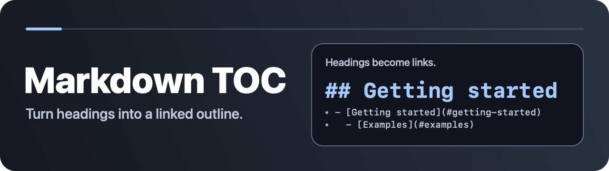
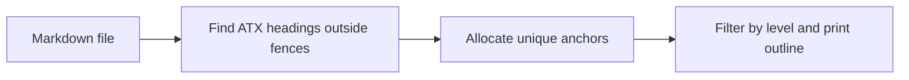

<p align="center">
  
</p>

# Markdown TOC

Build a linkable table of contents from a local Markdown file without editing it.

## At a glance

| Task | How |
| --- | --- |
| **Generate an outline** | Pass a Markdown file to print a linked table of contents. |
| **Choose heading levels** | Use `--min` and `--max` to select the depth. |
| **Handle repeat headings** | Repeated headings get numbered anchor suffixes. |

## Quick start

```sh
python3 markdown_toc.py README.md
python3 markdown_toc.py guide.md --min 1 --max 3
```

Requires Python 3.8+. It reads hash-prefixed headings, skips fenced code blocks, tracks repeated anchor names, and nests sections by heading level. The slug rules cover ordinary GitHub-style headings and simple inline links. Files with HTML headings, underline headings, or complex Markdown syntax may need manual adjustments. [MIT](LICENSE)

## Write an outline to a separate file

```sh
python3 markdown_toc.py guide.md --min 2 --max 4 > outline.md
```

Use a distinct output path because shell redirection opens the output before Python reads the input.



## Development

Run the dependency-free test suite from the repository root.

```sh
python3 -m unittest discover -s tests -v
```
